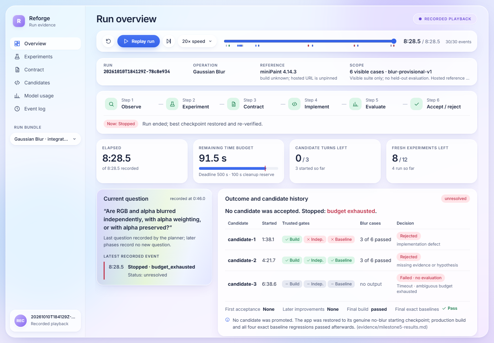

# Reforge run evidence dashboard

A static React + TypeScript dashboard that explains one Reforge learning run:
observe → experiment → contract → implement → evaluate → accept / reject.
It replays recorded harness evidence. It is separate from the generated
miniPaint-like editor in `generated-app/` and does not change it.



## Run it

```
cd dashboard
npm install
npm run dev        # http://127.0.0.1:5180/
npm test           # normalization tests (Node 24, no extra test framework)
npm run build      # type-check + static build into dist/
npm run preview    # serve dist/ at http://127.0.0.1:5181/
```

To choose a bundle, use the run picker or add `?run=<id>`, for example
`?run=synthetic-render-check`.

## What it shows

| View | Contents |
| --- | --- |
| Overview | Run identity, reference version, and scope. Current phase, elapsed time, remaining budget, and the current question. Candidate history with trusted gates, decisions, and the final outcome. |
| Experiments | Each fresh experiment: question, requested vs. accepted Percentage (exact-match check), input and reference output, purpose, hypotheses, and linked claims. |
| Contract | Claims with status filters, evidence links (which open the experiment or case), unresolved questions, and alternatives. |
| Candidates | Per-case RGB, alpha, and region results. An inspector that opens with the miniPaint reference and the generated app's output side by side, and can switch to reference, candidate, RGB diff ×16, alpha diff ×16, or input on their own. It has region overlays and parsed "why it failed" reasons. Also baseline regressions, failure routing, timeout errors, and builder telemetry. |
| Model usage | Recorded token usage per invocation. Missing telemetry is marked "Not recorded". |
| Event log | Every event, plus normalization warnings. Clicking an event seeks the replay. |

The replay bar supports restart, play/pause, jump to end, 1–60× speed, and a
scrubber. Every view only shows what was known at the cursor time.

## Bundled data

- **Recorded:** `recorded-20261010T184129Z-78c8e934`, Gaussian Blur
  integrated attempt 2. This is a minimal sanitized export (30 events, 56
  artifacts, about 205 KB), not the full archive.
  - The run was **unresolved**.
  - candidate-1 was rejected: an implementation defect, independent execution
    failed, and its baselines had missing output.
  - candidate-2 was rejected: missing evidence. It passed 3 of 6 cases;
    gb010, fresh-03 and fresh-04 had pixel mismatches.
  - candidate-3 hit the Codex execution deadline (TimeoutError).
  - The run stopped at 508.5 s on budget exhaustion. Recorded usage was
    1,257,517 tokens.
  - It is labeled **RECORDED PLAYBACK** on every screen.
- **Synthetic:** `synthetic-render-check`. This is invented edge-case data:
  schema v2, no stop event, unknown claim statuses, unknown event type,
  missing and unsafe image paths, a Percentage mismatch, and null usage.
  Every screen shows an orange **SYNTHETIC — NOT RESULTS** label.

The data format, normalization rules, exporter, and future live-integration
steps are in [DATA-CONTRACT.md](DATA-CONTRACT.md).

## Design notes

- **Layout** follows the reference admin dashboard: a left sidebar with a run
  picker and identity card, a page title with a mode badge, a warning
  banner for synthetic or unlabeled bundles, filter chips and segmented
  tabs, and tables with a detail panel.
- **Style** is restrained glassmorphism: translucent frosted panels over a
  pastel gradient with blurred light orbs, dark navy text for contrast,
  thin translucent white borders, and soft tinted shadows. Colors carry
  meaning only: green passed, red failed/rejected, amber missing or
  synthetic, blue pending/info.
- **Tokens:** every color, glass opacity, blur, gradient, shadow, radius,
  spacing step and type style comes from `../design-system/tokens.css`, which
  the design system owns and documents in `../design-system/index.html`. Vite
  inlines it into the dashboard CSS at build time, so nothing outside
  `dashboard/` is served. `styles.css` maps dashboard roles (`--good`,
  `--muted`, ...) onto those tokens. The only raw colors left are white, the
  opaque image checkerboard, and the region overlay colors.
- **Fonts:** Inter and JetBrains Mono load from Google Fonts, as on the design
  system page. Offline, the token font stacks fall back to system fonts.
- **Target sizes:** sized for a 1440×1000 judging screen. The overview fits
  the outcome and history above the fold. Breakpoints at 1280 px and 980 px
  keep it usable on laptops.
- **Images:** difference images render pixelated on a checkerboard. The
  evaluator scores raw RGBA; the checkerboard is display only.
- **Missing vs. failed:** "Not recorded" (no artifact in the bundle), "Artifact
  listed in bundle but could not be loaded" (broken file), "Missing output"
  (no candidate image, so no comparison), and "Pixel mismatch" (compared and
  failed) all look different.
- **No invented results:** no compatibility percentages and no derived scores.
  Model text is limited to concise final answers and route suggestions,
  labeled as such. Raw reasoning is never stored or shown.

Screenshots (1440×1000): `docs/screenshots/`. These include the overview,
candidate inspector, RGB difference, timeout, baselines, experiments,
contract, model usage, mid-replay, and the synthetic fixture with missing
artifacts.

## Limitations

- **Local feature jobs are supported.** Start `python -m features.service` from the repository root and open **Implement a feature**. Dev/preview proxy `/api/jobs` to loopback port 5190. Pilot execution is disabled by default; enabling it is a separate explicit action. Supported request: `Implement Contrast`. The UI polls persisted jobs and provides submission, cancellation, history, stage status, usage, evidence and events. These jobs are distinct from recorded playback. The generic replay SSE adapter is not a live job transport.
- **Only one recorded run is bundled.** Later runs (for example the
  brightness milestone) need `npm run export-run` and an index entry. The
  exporter has only been run against the blur run layout.
- **The reference build is unknown and unpinned**, as recorded by the
  harness. The dashboard reports it and does not resolve it.
- **Recorded artifacts are static exports in `public/runs/`.** Local jobs use the separate loopback service; a static deployed dashboard cannot execute them.


## Dashboard and feature integration

Branch: `codex/dashboard-feature-integration`, worktree `D:/Samuel/Downloads/Code/Reforge-integration`. It combines `codex/feature-discovery` through `ce01d7e` and `cursor/dashboard-glass-tokens` through `b0d24ad`. Feature controls follow the Aurora Glass tokens and composition rules; navigation remains available below 980px, and the reference/candidate inspector is preserved.

Preview: `http://127.0.0.1:5181/` (`npm run preview`). The review service has pilot execution disabled, so no paid learning run starts from the preview. Screenshots under `docs/screenshots/integration/` use explicit local test fixtures; their accepted/running job states are synthetic browser-test data, not additional Reforge results. The inspector screenshot shows the existing recorded Blur run.

Verification: 11 dashboard tests, TypeScript check and production build; 128 Python tests; expanded browser checks for submission, cancellation, queued/running/cancelling/accepted/unresolved/failed/cancelled states, history surviving refresh, evidence links, service outage, navigation at 980/390px, and side-by-side/difference inspector controls. The final visual refinement was verified by rerunning both browser tests. No model runs, candidate promotion, or merge into main were performed for this integration.
